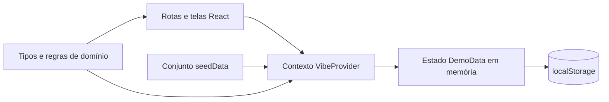

# Arquitetura do protótipo

## Visão geral

A VibeUp é uma aplicação React de página única com duas visões demonstrativas, estudante e empresa. O estado funcional é mantido no navegador, para que a apresentação rode sem serviço de backend. Os dados de início são fictícios e vêm de `src/seed.ts`.

## Partes do código

| Arquivo | Responsabilidade |
|---|---|
| `src/App.tsx` | Declara rotas e compõe a aplicação. |
| `src/Shell.tsx` | Navegação lateral e móvel, cabeçalho, busca global e troca da visão estudante/empresa. |
| `src/pages.tsx` | Telas de login demonstrativo, feed, publicar, perfil, busca, comunidades, desafios, eventos, mensagens, notificações, configurações, oportunidades e relatórios. |
| `src/ui.tsx` | Componentes visuais partilhados, diálogos, abas, avatares, cartões, compatibilidade e avisos temporários. |
| `src/domain.ts` | Modelos TypeScript, chave de armazenamento, geração de identificador de aba e regra local de compatibilidade. |
| `src/seed.ts` | Dados demonstrativos para estudantes, empresas, projetos e atividades. |
| `src/store.tsx` | Contexto React, operações de domínio, recuperação/migração leve do armazenamento local e persistência. |
| `src/index.css`, `src/App.css`, `src/Features.css` | Tipografia, tokens de cor, navegação, layout e estilos responsivos. |
| `public/brand/` | Marcas oficiais mantidas como referência visual no painel de login identificado. |

## Estado e fluxo

1. `VibeProvider` carrega `vibeup-demo-v1` do `localStorage` no início. Se não houver estado válido, usa `seedData()`.
2. A camada de contexto expõe operações como publicar, curtir, comentar, conectar, participar de evento/comunidade/desafio, enviar mensagem, candidatar-se e editar perfil.
3. Cada operação trabalha numa cópia do objeto `DemoData`; o efeito do provider grava o estado atualizado no mesmo navegador.
4. **Restaurar dados de demonstração** substitui o estado armazenado pelos dados originais da demonstração.

O formato de dados reúne usuários, projetos, publicações, oportunidades, comunidades, desafios, eventos, conversas, notificações, favoritos, candidaturas, conexões e preferências demonstrativas. Compatibilidade é uma comparação exata, sem distinção de caixa, entre os requisitos e habilidades declaradas ou listadas em projetos. O cálculo serve para descoberta no protótipo e não representa uma avaliação profissional.

## Rotas

`/login`, `/feed`, `/publicar`, `/perfil`, `/perfil/:id`, `/explorar`, `/comunidades`, `/desafios`, `/eventos`, `/mensagens`, `/notificacoes`, `/configuracoes`, `/empresas/oportunidades` e `/relatorios`. Rotas não reconhecidas mostram uma página 404. O seletor de papel troca o perfil corrente no armazenamento local e os menus de empresa são mostrados conforme o papel selecionado.

## Verificação de interface

`npm run capture:responsive` usa Playwright e um servidor Vite já ativo em `127.0.0.1:5173` (ou `VIBEUP_URL`) para registrar o feed nos cinco tamanhos da matriz e o painel de referência de marcas no login. Os PNGs e diagnósticos são guardados em `docs/screenshots/`. `npm run build` valida os tipos TypeScript e constrói os arquivos para produção.

## Limites

Não há API, banco de dados, autenticação real, sincronização, carregamento real de mídia nas publicações nem enforcement de privacidade. Os cadastros e controles de conta são demonstrações locais. Consulte [`requirements-matrix.md`](requirements-matrix.md) para os itens parciais e a lista de melhorias.
